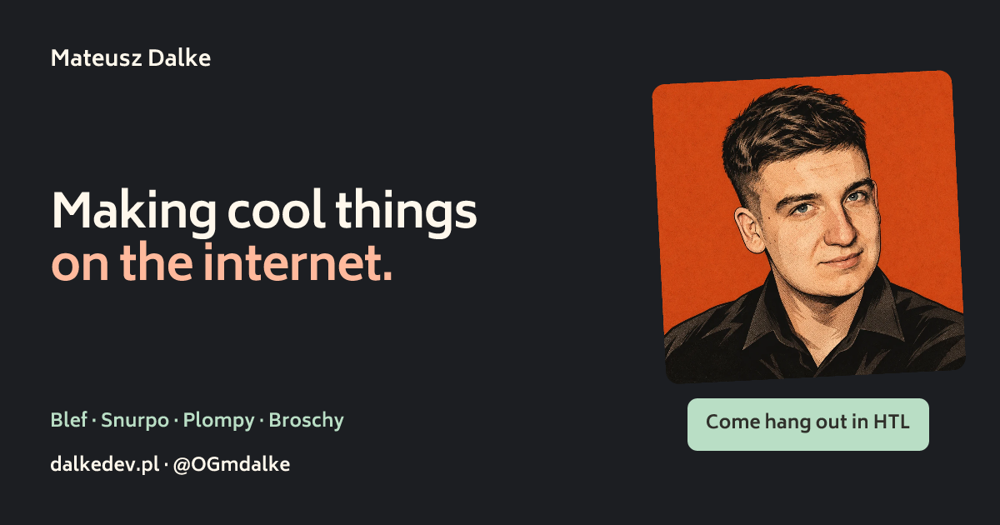
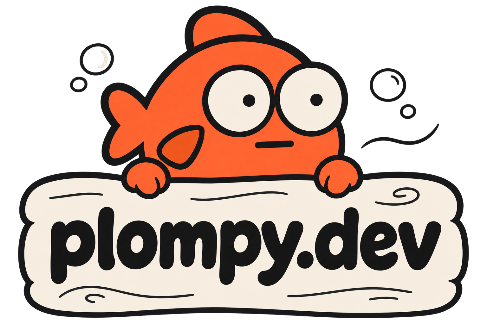

  

**[Visit dalkedev.pl ↗](https://www.dalkedev.pl/)**  
Explore my projects and experiments.

# Hey, I'm Mateusz.

I make things for the internet: games to play with friends, tools to poke around with, and experiments that turn into real projects.

Try something, look through the code, or come say hi. Ideas and weird bug reports are welcome.

[My corner of the internet](https://www.dalkedev.pl/) · [Find me on X](https://x.com/OGmdalke) · [Join HTL on Discord](https://discord.gg/SVPwBs8GQh)

## Come hang out

**[HTL](https://discord.gg/SVPwBs8GQh)** is my community around programming, cybersecurity, and AI. Bring a project, a question, or something you want to figure out. I'm also building SzpontHTL for the community, with technical news, practice challenges, and a human Code Review Clinic.

## Things I've made

### [Blef ↗](https://playblef.com)

A free browser party game for 3-8 friends. Tell a true or made-up story, vote on each other's bluffs, and reveal the answers together. Private rooms, chat, reactions, and a little table-tug duel while you wait for the crew. In Polish and English, with no account or installation.

**TypeScript · Next.js · NestJS · Socket.IO**

[Play Blef](https://playblef.com) · [Game rules](https://playblef.com/zasady)

### [Snurpo ↗](https://snurpo.dev)

A nosy little HTTP debugger. Look inside the conversation between an app and its API. Capture and edit traffic, revisit saved sessions, connect Android apps, and share selected evidence with an MCP client.

**Rust · Tauri · React · TypeScript · SQLite**

[Website](https://snurpo.dev) · [Source](https://github.com/dalkedev/snurpo) · [Downloads](https://github.com/dalkedev/snurpo/releases) · [How it works](https://github.com/dalkedev/snurpo/blob/main/docs/ARCHITECTURE.md)

### [plompy-engine ↗](https://plompy.dev)

A self-hosted agent engine with two ways to work. Private Discord threads keep their coding sessions, durable SQLite queue and Markdown memory. **Plompy Local** ships ready-made Docker images for a separate MCP server used by **Codex, Claude Code and OpenCode**: selected integrations, public-source research, email drafts and local file exports, without requiring Discord or a second agent.

Want a self-hosted model too? Optionally configure **Ollama** as your chosen agent's model provider with a compatible, tool-capable model. Plompy provides the tools; the agent runs the conversation. See [Ollama setup and compatibility](https://plompy.dev/docs/ollama/) for requirements and verification limits.

**TypeScript · Node.js · Docker · MCP · SQLite · Playwright · Camoufox**

[Website](https://plompy.dev) · [Source](https://github.com/dalkedev/plompy-engine) · [Documentation](https://plompy.dev/docs/) · [Run locally](https://plompy.dev/docs/quickstart/) · [Connect your agent](https://plompy.dev/docs/other-clients/)

### [Broschy ↗](https://github.com/dalkedev/Broschy)

A native macOS notch companion that keeps focus sessions, Spotify, coding-agent activity, and build signals within reach. A detour into making everyday tools feel at home on the desktop.

**Swift · SwiftUI · AppKit**

## More experiments

- **[game-server](https://github.com/dalkedev/game-server):** a multiplayer lobby and game prototype with rooms, player sessions, and live movement over WebSockets. Built with Go, PostgreSQL, and Redis.
- **[dummysensors](https://github.com/dalkedev/dummysensors):** simulated sensor signals for Python projects and the command line.
- **[wakacjepl-scraper](https://github.com/dalkedev/wakacjepl-scraper):** an educational project exploring travel-offer data and price history with Bun, TypeScript, and SQLite.

Some projects become useful tools. Some stay experiments. They're all part of figuring things out by making them.

---

[Say hi on X](https://x.com/OGmdalke) · [Email me](mailto:dalke.dev@gmail.com) · [LinkedIn](https://www.linkedin.com/in/mateusz-dalke/) · [Buy me a coffee](https://buymeacoffee.com/dalkedev)
