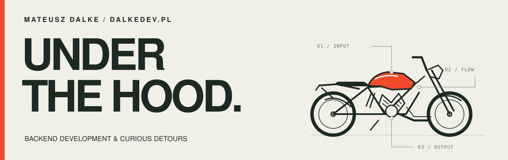

  

# Mateusz Dalke

**Backend developer · Bydgoszcz, Poland**

I build APIs, developer tools, and applications with a lot happening behind the interface. My projects tend to follow the same curiosity: where does a request go, how does state change, and what happens when something breaks?

[Website](https://www.dalkedev.pl/) · [LinkedIn](https://www.linkedin.com/in/mateusz-dalke/) · [Email](mailto:dalke.dev@gmail.com)

## Selected work

### [Scope ↗](https://github.com/SculptTechProject/scope)

A desktop HTTP(S) debugger for looking inside the conversation between an app and its API. Capture and edit traffic, revisit saved sessions, connect Android apps, and share selected evidence with an MCP client.

**Rust · Tauri · React · TypeScript · SQLite**

[Alpha downloads](https://github.com/SculptTechProject/scope/releases) · [How it works](https://github.com/SculptTechProject/scope/blob/main/docs/ARCHITECTURE.md)

### [game-server ↗](https://github.com/SculptTechProject/game-server)

A multiplayer lobby and game prototype: rooms, player sessions, and live movement over WebSockets. A small world for exploring concurrency, shared state, and event delivery.

**Go · PostgreSQL · Redis · WebSockets**

### [Broschy ↗](https://github.com/SculptTechProject/Broschy)

A native macOS notch companion that keeps focus sessions, Spotify, coding-agent activity, and build signals within reach. A detour into making everyday tools feel at home on the desktop.

**Swift · SwiftUI · AppKit**

## What I like working on

- **The request lifecycle:** APIs, queues, persistence, and useful failure handling.
- **Systems in motion:** concurrent services, live events, and the state between them.
- **Tools that explain themselves:** inspectable traffic, clear diagnostics, and less guesswork.

My work spans **C# / .NET, Java / Spring Boot, TypeScript / Node.js, and Go**. I also build the interface when a project needs one.

---

Away from the keyboard: Japanese motoring and the gym.
